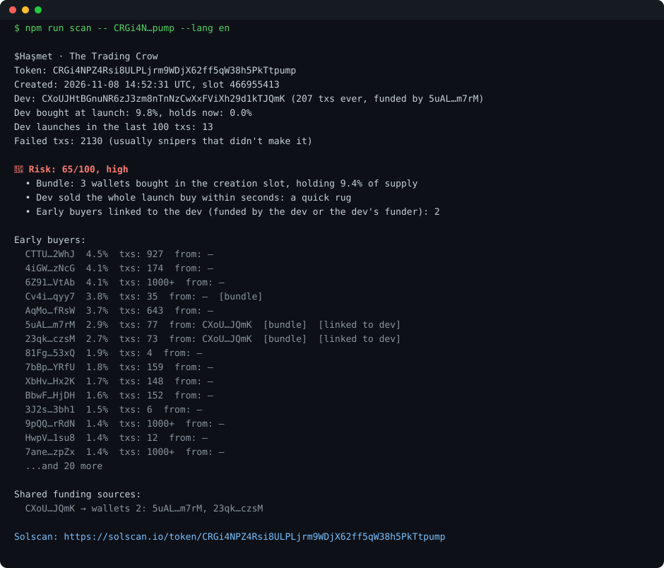
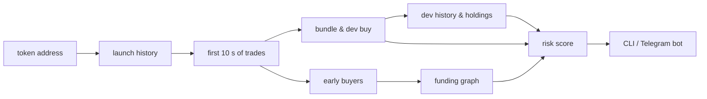

# rug-radar

**On-chain rug and bundle detector for pump.fun launches on Solana.**
Give it a token address, and in 5–15 seconds it tells you how risky the launch is and shows the evidence: who bought in the creation slot, what the dev did, and where the early buyers' SOL came from.

[Русская версия](README.ru.md) · [Calibration report](CALIBRATION.md)

## What you're looking at

A real launch from November 2026. The dev wallet had only 39 transactions and was funded by wallet `Bynz…sGof`. That same wallet bought 1.4% of the token itself and had funded four fresh wallets (12–14 transactions each), which all bought in the very slot the token was created. The dev sold the entire launch buy within seconds.

None of this is visible on the token page. All of it is on chain, and rug-radar puts it together in one report.

## What it checks

| Signal             | What it means                                                                                       |
| ------------------ | --------------------------------------------------------------------------------------------------- |
| **Bundle**         | wallets that bought in the same slot the token was created, and how much of the supply they took    |
| **Dev behaviour**  | how much the dev bought at launch, how much is left, and whether it was dumped in the first seconds |
| **Launch factory** | how much of the dev wallet's recent activity is launching tokens                                    |
| **Funding graph**  | where the dev and the early buyers got their first SOL; shared sources and links back to the dev    |
| **Early demand**   | whether anyone besides the dev bought in the first 10 seconds                                       |

The output is a 0–100 score, a risk band, and a plain-language list of reasons, in Russian or English.

## Calibrated on real launches

The weights are not guessed. 250 random pump.fun launches were scanned and then checked 40–120 minutes later: did the price ever reach 2× from a sniper's entry (10 seconds after launch), or did it never get past 1.3×?

| Risk band | Launches | Dumped  | Went 2×+ |
| --------- | -------- | ------- | -------- |
| **high**  | 62       | **97%** | **3%**   |
| medium    | 68       | 91%     | 6%       |
| low       | 120      | 70%     | 17%      |

- Hand-set weights scored like a coin flip (AUC 0.50). Fitted weights: **AUC 0.73 on 5-fold cross-validation** (0.69–0.75 across 20 shuffles).
- New rules are checked on launches they were not designed on. The launch-factory rule was picked on the first 150 launches, then run on 100 fresh ones: **AUC on those went from 0.63 to 0.72**.
- The baseline is brutal: **82% of launches never give a sniper even 1.3×**. rug-radar doesn't promise winners; it flags launches that are worse than that baseline.

What the data showed, some of it counter-intuitive:

- **"The dev launched other tokens" means little.** 86% of launches come from such devs. What matters is the share: wallets where launches are 20%+ of recent activity dumped 93% of the time and went 2×+ in 5%, against 77% and 14% for the rest. On the 100 fresh launches: 97% against 74%.
- **A dev selling later is not a red flag.** Launches where the dev had sold out (but not in the first seconds) went 2×+ more often, 16% vs 5%: devs take profit on the ones that work.
- **The other real tells:** a brand-new dev wallet (23 of 25 dumped), two or more early buyers funded from the dev's own source (8 of 8), and nobody but the dev buying in the first 10 seconds (91% dumped vs 75%).

Full tables: [CALIBRATION.md](CALIBRATION.md).

## Under the hood

- **Robust to protocol upgrades.** pump.fun keeps shipping new instruction versions and transaction formats; rug-radar reads what changed on chain instead of decoding instructions, so upgrades don't break it.
- **Price history without an indexer.** The price at any past moment is recovered from a single transaction, so outcomes can be measured with plain RPC calls.
- **Every new launch from a single account.** New pump.fun tokens are discovered without scanning blocks.
- **Runs on free infrastructure.** Adaptive rate limiting and automatic RPC fallback; one scan costs a few hundred RPC calls and takes 5–15 seconds on a free endpoint.

## Delivery

- **CLI** with human-readable and JSON output
- **Telegram bot**: answers in the user's language, shares one scan between users asking about the same token, per-user daily limits
- **Docker** image for hosting

Stack: TypeScript (strict), @solana/web3.js, grammY, node:test, ESLint, Prettier, GitHub Actions.

## Status

The detector, the bot and the calibration pipeline are working. Next: a public bot, a list of exchange hot wallets to avoid false funding links, a deeper funding graph, and a larger calibration sample.

---

The source code is private. This repository only describes the project.
Not financial advice: rug-radar reports what is on chain.
