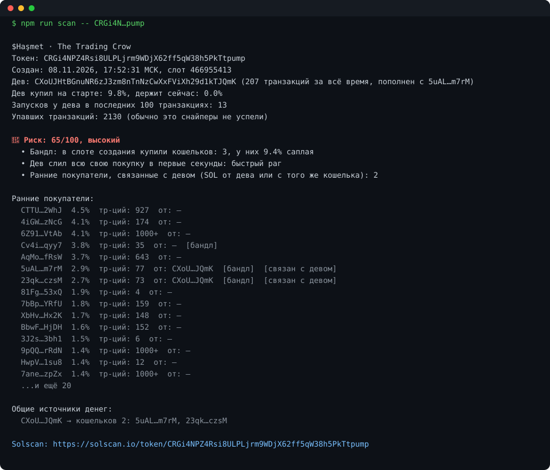
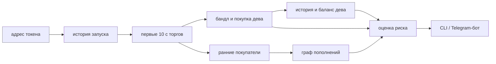

# rug-radar

**Детектор рагов и бандлов для запусков на pump.fun (Solana).**
Даёшь адрес токена, через 5–15 секунд получаешь оценку риска и доказательства: кто купил в слоте создания, что делал дев и откуда у ранних покупателей SOL.

[English version](README.md) · [Отчёт о калибровке](CALIBRATION.md)

## Что на картинке

Реальный запуск, ноябрь 2026. У кошелька дева всего 39 транзакций, пополнен он с кошелька `Bynz…sGof`. Этот же кошелёк сам купил 1.4% токена и заранее пополнил четыре свежих кошелька (по 12–14 транзакций), которые все купили в том же слоте, где токен был создан. Дев слил всю свою покупку за секунды.

На странице токена ничего этого не видно. Всё это есть в блокчейне, и rug-radar собирает это в один отчёт.

## Что проверяет

| Признак               | Что это значит                                                                       |
| --------------------- | ------------------------------------------------------------------------------------ |
| **Бандл**             | кошельки, купившие в том же слоте, где создан токен, и какую долю саплая они забрали |
| **Дев**               | сколько купил на старте, сколько осталось, не слил ли всё в первые секунды           |
| **Конвейер запусков** | какую часть недавней активности кошелька дева составляют запуски токенов             |
| **Граф пополнений**   | откуда дев и ранние покупатели получили первые SOL; общие источники и связи с девом  |
| **Ранний спрос**      | купил ли кто-то, кроме дева, в первые 10 секунд                                      |

На выходе оценка 0–100, зона риска и список причин простым языком, на русском или английском.

## Откалиброван на реальных запусках

Веса не взяты с потолка. 250 случайных запусков pump.fun отсканированы и проверены через 40–120 минут: дала ли цена хоть раз 2× от входа снайпера (через 10 секунд после старта) или так и не поднялась выше 1.3×.

| Зона риска  | Запусков | Слились | Дали 2×+ |
| ----------- | -------- | ------- | -------- |
| **высокий** | 62       | **97%** | **3%**   |
| средний     | 68       | 91%     | 6%       |
| низкий      | 120      | 70%     | 17%      |

- Веса «на глаз» работали как монетка (AUC 0.50). Подобранные по данным: **AUC 0.73 на 5-fold кросс-валидации** (0.69–0.75 на 20 перемешиваниях).
- Новые правила проверяются на запусках, на которых их не подбирали. Правило про конвейер запусков найдено на первых 150 запусках и прогнано на 100 свежих: **AUC на них вырос с 0.63 до 0.72**.
- Базовая статистика жёсткая: **82% запусков не дают снайперу даже 1.3×**. rug-radar не обещает иксы, он отсекает запуски хуже этой базы.

Что показали данные, местами неочевидное:

- **«Дев запускал другие токены» почти ни о чём не говорит.** Так устроены 86% запусков. Важна доля: кошельки, где запуски составляют 20%+ недавней активности, слились в 93% случаев и дали 2×+ в 5%, против 77% и 14% у остальных. На 100 свежих запусках: 97% против 74%.
- **Дев, продавший позже, это не красный флаг.** Там, где дев вышел (но не в первые секунды), 2×+ случались чаще, 16% против 5%: девы фиксируют прибыль на удачных запусках.
- **Остальные настоящие признаки:** совсем новый кошелёк дева (слились 23 из 25), двое и больше ранних покупателей с деньгами из источника дева (8 из 8) и никто, кроме дева, не купил в первые 10 секунд (91% слились против 75%).

Полные таблицы: [CALIBRATION.md](CALIBRATION.md).

## Как устроено

- **Не ломается от обновлений протокола.** pump.fun постоянно выпускает новые версии инструкций и форматы транзакций; rug-radar смотрит, что изменилось в блокчейне, а не разбирает инструкции, поэтому обновления его не ломают.
- **История цены без индексатора.** Цену в любой прошлый момент можно восстановить по одной транзакции, так что исходы считаются обычными запросами к RPC.
- **Все новые запуски через один аккаунт.** Новые токены pump.fun находятся без перебора блоков.
- **Работает на бесплатной инфраструктуре.** Адаптивное ограничение скорости и автоматический запасной RPC; одна проверка это несколько сотен запросов и 5–15 секунд на бесплатном узле.

## Формат

- **CLI** с понятным отчётом и выводом в JSON
- **Telegram-бот**: отвечает на языке пользователя, один скан на токен делится между всеми, кто его спрашивает, дневные лимиты
- **Docker**-образ для хостинга

Стек: TypeScript (strict), @solana/web3.js, grammY, node:test, ESLint, Prettier, GitHub Actions.

## Статус

Детектор, бот и калибровка работают. Дальше: публичный бот, список горячих кошельков бирж против ложных связей, более глубокий граф пополнений и выборка побольше.

---

Исходный код закрыт. Этот репозиторий только описывает проект.
Не финансовый совет: rug-radar показывает то, что есть в блокчейне.
